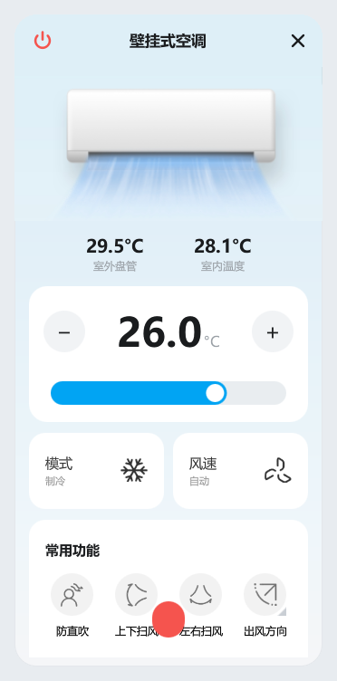
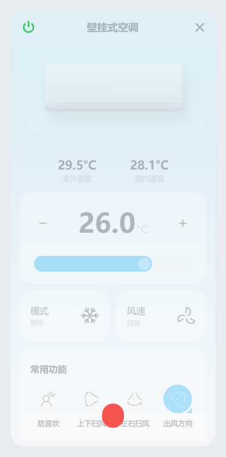

# midea-tray

Windows 托盘里的美的空调控制器。局域网直连，不经过云端，界面按「美的美居」App 复刻。

官方 App 每次开空调要点四五下、看广告、还得联网。这个项目把它压成：点托盘图标 → 拖一下温度 → 完事。

| 开机 | 关机 |
|---|---|
|  |  |

## 功能

- **托盘常驻**：图标直接显示设定温度（开机）或室温（关机），鼠标悬停看详细状态
- **完整控制面板**：温度滑条、模式、风速、开关机
- **功能图标**：防直吹、上下扫风、左右扫风、出风方向、强冷、省电、电辅热、智控温
- **出风方向**：五档上下 + 五档左右，跟 App 一致
- **设备设置**：屏显、声音、干燥防霉、智能光感
- **今日用电**：从设备读取当日累计电量
- **关机态置灰**：整页降到 30% 透明度，电源键保持清晰（绿色）
- **指令失败提示**：面板底部弹出中文原因，3 秒自动消失

## 原理

美的空调在局域网里跑一套私有协议（M-Smart），TCP 6444 控制、UDP 6445 发现，载荷用 AES 加密，V3 设备还需要从云端换一次 token/key。

协议层用 [msmart-ng](https://github.com/mill1000/midea-msmart)，本项目在它之上做了三件事：

1. **补齐了库里没实现的扩展字段**。设备会回属性 `0x007E`（55 字节的镜像全量状态），msmart-ng 的枚举表里没有，直接丢弃。这里解出了干燥防霉、智控温、智能光感的标志位——这些功能在标准协议帧里根本不存在，官方 App 是走云端的。
2. **修正了 SetState 帧的扩展位**。所有控制指令都必须带上扩展功能位，否则设备会把对应功能当成"关闭"。早期版本点「声音」会导致干燥防霉被意外关掉，就是这个原因。
3. **多网段自动重连**。空调的 Wi-Fi 会在光猫和主路由之间漂移（实测从 192.168.1.x 跳到 192.168.110.x），程序会扫描已知网段重新定位设备。

## 安装

要求 Windows 10/11 + Python 3.10 以上。

```bat
git clone https://github.com/LLLLOOK/midea-tray.git
cd midea-tray
install.bat
```

## 首次配置

```bat
setup.bat
```

按提示输入美的美居账号密码，脚本会向云端换取这台设备的 `token` / `key`，写入 `ac_config.json`。**只需要做一次**，之后完全本地运行。

拿到的配置长这样：

```json
{
  "ip": "192.168.1.100",
  "port": 6444,
  "device_id": 123456789012345,
  "token": "<128 位十六进制>",
  "key": "<64 位十六进制>",
  "known_subnets": ["192.168.1.", "192.168.110."]
}
```

> `ac_config.json` 已经在 `.gitignore` 里，**不要提交**——它等同于空调的钥匙。

配好后双击 `run.bat` 启动，托盘会出现温度图标，左键点开面板。

## 已知限制

- **只支持空调**（设备类型 `0xAC`），不支持风扇、热水器等其他 M-Smart 设备
- **只支持单台**，多设备需要改 state 结构
- **云功能做不了**：定时、电量统计（历史）、智清洁记录这些走云端接口，局域网协议里没有
- **智控温 / 智能光感**：设备会忽略局域网下发的对应位，App 走的是云端通道。界面里这两项是禁用态
- **电辅热**仅制热模式可用
- 空调 IP 变化后首次连接会慢几秒（在扫网段找它）

## 目录结构

```
midea_tray.py      主程序：托盘、轮询、协议扩展
pyside_panel.py    Qt 桥接层：把 Controller 状态暴露给 QML
panel.qml          界面（Qt Quick，871 行）
get_token.py       国服账号换 token
install.bat        建 venv + 装依赖
setup.bat          取 token
run.bat            启动
icons/             图标资源（SVG 源 + PNG 成品）
fonts/             HarmonyOS Sans SC（子集化，见下）
test_pyside_panel.py  离屏渲染测试，不连真机
```

## 测试

```bat
.venv\Scripts\python.exe test_pyside_panel.py
```

用 `fake_ctrl.py` 里的假设备跑离屏渲染，校验 QML 零错误、状态字段齐全、拖拽逻辑正常，并导出 6 张截图。不需要真机。

## 字体

界面用 [HarmonyOS Sans SC](https://developer.harmonyos.com/cn/docs/design/font-0000001157868583)，华为免费公开的字体。仓库里那份做过子集化（7.88 MB → 0.90 MB），只保留界面用到的字符 + GB2312 一级常用字，改文案一般不会缺字。

## 致谢

- [msmart-ng](https://github.com/mill1000/midea-msmart) — 协议实现的基础
- [midea-local](https://github.com/georgezhao2010/midea_ac_lan) — 国服账号换 token 的接口
- 界面参考「美的美居」App，版权归美的所有，这里仅为个人使用复刻

## License

MIT
